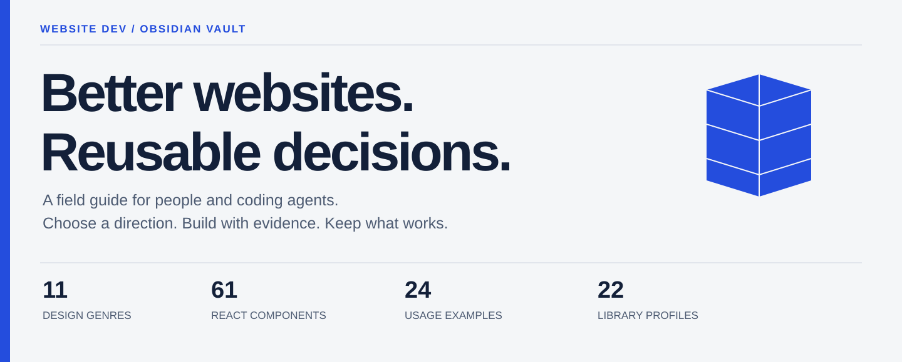
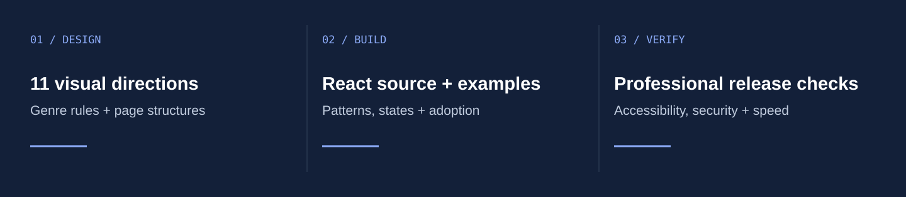
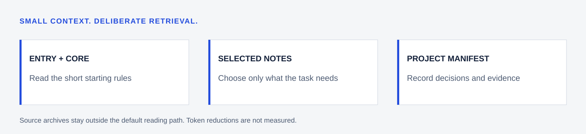

<picture>
  <source media="(max-width: 600px)" srcset="docs/assets/cover-mobile.svg">
  
</picture>

<p align="center">
  <a href="vault/00%20Start/Quick%20Start.md"><b>Get started</b></a> &nbsp; / &nbsp;
  <a href="vault/02%20Genres/Design%20Genres.md">Explore genres</a> &nbsp; / &nbsp;
  <a href="vault/04%20React/Component%20Index.md">Browse React</a> &nbsp; / &nbsp;
  <a href="CONTRIBUTING.md">Contribute</a>
</p>

A portable Obsidian library for building distinctive, professional websites with people and AI agents. **161 focused notes**, source-backed guidance and reusable project recipes. No required community plugins.

<picture>
  <source media="(max-width: 600px)" srcset="docs/assets/library-map-mobile.svg">
  
</picture>

### Open it

1. **[Download ZIP](https://github.com/Fai1th/Website-Dev-Obsidian-Vault/archive/refs/heads/main.zip)** or clone this repository.
2. Extract it, then choose **Open folder as vault** in Obsidian.
3. Select the **`vault`** folder and open **[START HERE](vault/START%20HERE.md)**.

### Find your next decision

| Design | Build | Deliver |
| :--- | :--- | :--- |
| [11 design genres](vault/02%20Genres/Design%20Genres.md) | [61 React component cards](vault/04%20React/Component%20Index.md) | [Accessibility](vault/06%20Quality/Accessibility%20Rules.md) |
| [Type, colour, layout, motion](vault/01%20Foundations/Foundations.md) | [22 library profiles](vault/04%20React/React%20Library%20Index.md) | [Security controls](vault/05%20Security/Security%20Map.md) |
| [Page structures](vault/03%20UI/Page%20Structures.md) | [Component adoption recipe](vault/04%20React/Component%20Adoption%20Recipe.md) | [Release checklist](vault/06%20Quality/Professional%20Release%20Checklist.md) |
| [Inspiration + inspection limits](vault/08%20Inspiration/Inspiration%20Index.md) | [Filled project example](vault/10%20Projects/Example%20Project%20Manifest.md) | [Source provenance](vault/90%20Sources/Source%20Provenance.md) |

### Use it with an agent

<picture>
  <source media="(max-width: 600px)" srcset="docs/assets/retrieval-mobile.svg">
  
</picture>

> Read `vault/AGENT START.md`, then the core rules and only the notes relevant to this project. Follow the project's own instructions. Record selected sources, versions and exceptions in a project manifest.

### What is verified?

The repository validator checks local links, selected privacy patterns, metadata and **90 pinned upstream source hashes**. React files are reference snapshots that require project integration and runtime checks. Inspiration notes distinguish inspected work from blocked or partial leads. Token savings are not measured.

```sh
python scripts/validate.py
```

**[MIT](LICENSE)** for original content and artwork. Bundled shadcn/ui code retains its own MIT notice. **[Third-party attribution](THIRD_PARTY_NOTICES.md)** · **[Changelog](CHANGELOG.md)** · **[Security](SECURITY.md)**
