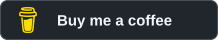

# Website Dev Vault

Obsidian notes and React references for repeatable website development.

[Get started](vault/00%20Start/Quick%20Start.md) · [Design genres](vault/02%20Genres/Design%20Genres.md) · [React components](vault/04%20React/Component%20Index.md)

## Open in Obsidian

1. [Download](https://github.com/Fai1th/Website-Dev-Obsidian-Vault/archive/refs/heads/main.zip) and extract the repository, or clone it.
2. Choose **Open folder as vault** in Obsidian and select the **`vault`** folder.
3. Open **[START HERE](vault/START%20HERE.md)**. No community plugins required.

## Library

| Area | Contents |
| :--- | :--- |
| [Design](vault/01%20Foundations/Foundations.md) | Typography, colour, layout, motion and 11 design genres |
| [UI & React](vault/04%20React/React%20Catalogue.md) | 61 component sources, 24 examples and 22 library profiles |
| [Quality](vault/06%20Quality/Quality%20Map.md) | Accessibility, performance and release checks |
| [Security](vault/05%20Security/Security%20Map.md) | Practical controls with primary-source references |
| [Workflow](vault/07%20Workflows/Build%20Workflow.md) | Project templates, adoption recipes and recorded decisions |

## Agent use

Start with [`vault/AGENT START.md`](vault/AGENT%20START.md). Read the core rules, then select only the notes needed for the project. Keep decisions and source versions in a [project manifest](vault/10%20Projects/Example%20Project%20Manifest.md).

<details>
<summary>Source and validation notes</summary>

React sources are pinned snapshots that need integration and testing in the target project. The validator checks local links, selected sharing patterns and 90 upstream source hashes.

```sh
python scripts/validate.py
```

See [source adoption](vault/04%20React/Source%20Adoption.md) and [attribution](THIRD_PARTY_NOTICES.md). Inspiration notes record inspection limits. Token savings are not measured.

</details>

## Support

[](https://buymeacoffee.com/fai1th)

[Contributing](CONTRIBUTING.md) · [Changelog](CHANGELOG.md) · [MIT license](LICENSE)
